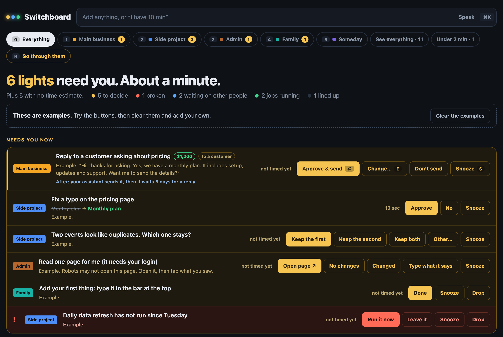

# Switchboard

**One screen on your own computer for everything your AI assistants and scripts are waiting on you for.**

Your scripts and AI sessions do 90% of the work, then stop and wait for you,
each in its own terminal or chat. Switchboard gives them one place to raise a
hand. You see the draft and approve it, change it or say no. The assistant
picks up your answer the next time it checks in, does the sending, and reports
back.

- **It runs on your computer.** A small Node server on 127.0.0.1 and one JSON file. No account, no cloud, no dependencies. It makes no network calls of its own.
- **It never sends anything itself.** Your assistant or script sends, after you approve, and reports "sent", "failed" or "not sure".
- **Assistants can't approve for you.** There is no approve tool. The MCP tools and the HTTP API can raise, update and collect. Only the page you opened through your key link can approve or take back.



## Try it in one minute

You need [Node.js](https://nodejs.org) 18 or newer. Nothing else to install.

```sh
git clone https://github.com/ZCOLLINSKY/switchboard.git
cd switchboard
node cli.js sim --open
```

No git? On the GitHub page, click **Code**, then **Download ZIP**, unzip it,
and run `node cli.js sim --open` in that folder.

To get a terminal in a folder: on a Mac, open **Terminal**, type `cd ` (with a
space), drag the folder onto the window and press Return. On Windows, open the
folder, click the address bar, type `powershell` and press Enter: PowerShell
opens in that folder.

A made-up busy morning opens in your browser, and new things arrive while you
watch. It keeps its own data and never touches a real board. Ctrl+C stops it.

## Install

You need Claude Code or Claude Desktop on your own computer: a Mac or a Windows
PC (Claude Code also runs on Linux). Claude on the web or on a phone cannot use
Switchboard: those chats run in Anthropic's cloud and cannot reach a board on
your computer. You can still open the board itself on your phone
([SETUP.md](SETUP.md), step 8).

**Claude Code** (needs [Node.js](https://nodejs.org) 18 or newer). Paste these
two lines into a session:

```
/plugin marketplace add ZCOLLINSKY/switchboard
/plugin install switchboard@zcollinsky
```

Start a new session and say "Open my Switchboard, then set it up for me."

**Claude Desktop** (nothing else to install): download the `.mcpb` file from
the [latest release](https://github.com/ZCOLLINSKY/switchboard/releases/latest),
double-click it, and click Install. In a new chat, say "Open my Switchboard,
then set it up for me." Claude Desktop starts the board for you; keep the app
open while you use it. Nothing checks the board between chats, so after you
answer on the board, wait a minute or two (every answer can be taken back for
20 seconds to 2 minutes), then start a chat and say "check my Switchboard".

**Any other assistant, or no plugin:** get the folder (`git clone` as above, or
**Download ZIP**) and follow [Let your AI assistant set it up](#let-your-ai-assistant-set-it-up).

## The idea

Every piece of work is a **light**, and a light always says who holds the ball:

| Light | Meaning |
|---|---|
| Gold | Needs you: approve a draft, pick an option, or look at something a robot can't open |
| Gold ring | Approved, not yet sent. You said yes; your assistant hasn't reported it done. Once an assistant has checked in that day, an approval nobody collects in 15 minutes turns red; before that it says it is waiting for one |
| Blue | Sent, and waiting on someone else. It doesn't count against you. If they go quiet, it comes back gold with a follow-up. You can say "They replied" or "Stop following up" |
| Green | Running by itself. Amber if it goes quiet past the time it promised |
| Red | An automation broke |
| Dim | Queued, or asleep until a date |

Clearing the gold lights is the whole job. When there are none, the screen says
**"0 lights need you right now."**

What makes it different from a to-do list:

- **The draft is attached.** You approve, edit, or say no. You don't go find the thread.
- **You approve what you read.** A message to a person is shown whole. If an assistant changes a draft, a recipient or an attachment after it is on your screen, the row says so and its buttons stop until you look again. What you approved is frozen: the assistant is handed those words, that recipient and those files, whatever the light says later. A held key never approves twice.
- **Every tap can be undone.** A decision waits before any agent can act on it (20 seconds; 60 for a message to a person, with "Skip the wait", and "Hold until 7:45 am" outside working hours), and a "Just now" strip lists each one with Undo, even after a reload. An approval no assistant has picked up yet can be taken back from its row at any time.
- **Nothing is retried blind.** If an assistant cannot tell whether a message went out, you are asked "It went out / It did not go out" before anything is sent again.
- **Nothing runs by itself unless you switch it on.** Even then, only a typed change (a from and a to, no free text, nobody to send to) can, after ten single approvals on three different days, in one container. Messages to people always wait for your tap.
- **The time is real.** Estimates come from how long you actually take.
- **You can be the eyes.** An agent that hits a login wall asks you to open the page and tap what you saw.

<details>
<summary>Everything else it does</summary>

- **Rules are watched.** The first five automatic runs all come back for a look, then one now and then at random. "Your rules" lists every rule with an off switch, and a sudden spike pauses a rule and asks.
- **Nothing goes stale quietly.** An old reply says who has been waiting ("Dale has waited 2 days"). A job that goes quiet past the time it promised turns amber and breaks "All clear". The third snooze asks you to do it, drop it, or give it a date.
- **Slammed days stay calm.** The queue is ordered by meaning: what is due within a day, then messages to people waiting on you (the bigger quote first among those), then broken jobs that hold something up, then the rest by age. Identical changes collapse into one "Approve all 8" row. A long queue shows the top five, and never folds away a deadline or a blocker.
- **The minutes are honest.** The headline counts taps, using the middle of your last ten for each job type. Work away from the board ("chores") and anything not timed yet are counted apart, never guessed in.
- **Change… in one place.** Edit the words yourself, or tell your assistant what to change (by typing, one-tap notes you have used before, or speaking). The new version comes back with your request, the assistant's own line on what it changed, and the changed words marked. Ask for the same thing twice and Switchboard offers to make it a standing rule for that container.
- **It remembers what you told them.** A reply or follow-up shows the last message you sent that person, and flags a different price, day or time ("Earlier you said $1,450; this says $1,350"). Every message gets a one-line check: amounts, days, times and who it goes to.
- **Since you last looked.** Back after a few hours, one short block says what is new, what went out and what broke, per container.
- **Go through them.** One card at a time, everything that is waiting, longer jobs last. On a phone the board opens on it.
- **"I have 10 minutes."** Type that (or "I have an hour") in the bar and it shows only what fits, counting down as you go.

</details>

## Use it for real (2 minutes)

In the same folder:

```sh
node cli.js start --open
```

It prints a link with a key in it. Open the board through that link once in each
browser you use: that is what lets the browser approve things. Any other browser,
and any script, can read the board but not act on it. `node cli.js link`
prints the link again, and `node cli.js stop` stops the board. Run `npm link` once in this folder if you would rather type `switchboard link`.

Then, in a second terminal, in the same folder, load the examples so you can try the buttons:

```sh
node cli.js demo
```

Your data stays on your computer, in `~/.local/share/switchboard/data.json`.

## Let your AI assistant set it up

If you use Claude Code (or any assistant that can run commands), open it in this
folder and say:

> Set up Switchboard for me. Follow SETUP.md.

It will start the board, connect itself, ask what you have going, and put your
real lights on it. What it changes on your machine: it adds the `switchboard`
MCP server to your assistant's settings and copies one skill into
`~/.claude/skills`. Your assistant may ask you to approve (or paste) each of
those. It asks before it adds a line to your `~/.claude/CLAUDE.md` or sets the
board to start at login. The new tools load in its next session, so you start
one more. Setup is done once you have tapped one light on the board and it has
picked up your answer. [SETUP.md](SETUP.md) is short if you would rather read
it first.

To connect Claude Code by hand instead, from this folder:

```sh
claude mcp add --scope user switchboard -- node "$PWD/mcp.js"
```

## How anything turns on a light

**From an AI assistant** (MCP): Switchboard ships an MCP server with tools such
as `raise_light`, `get_decisions` and `update_light`. See [SETUP.md](SETUP.md).

A round trip: the assistant calls `raise_light` with the draft and who it goes
to, and keeps working. You tap Approve. The next time it calls `get_decisions`
it is handed exactly the words you approved, sends them, and calls
`complete_decision` with `sent`. If it gave `follow_up_days`, the light turns
blue and waits for the reply.

**From a script:**

```sh
curl -X POST http://127.0.0.1:4747/api/lights \
  -H 'content-type: application/json' \
  -d '{"agent":"my-script","area":"Shop","title":"Reply to the customer","draft":"Hi, thanks for asking…","outbound":true,"follow_up_days":3}'
```

**From the command line:**

```sh
node cli.js raise --area "Shop" --title "Order more boxes" --kind todo
node cli.js raise --area "Shop" --title "Which size?" --kind decide --options "Small,Large"
```

Then your script collects what you decided, acts, and reports back:

```sh
curl -X POST http://127.0.0.1:4747/api/decisions \
  -H 'content-type: application/json' -d '{"agent":"my-script"}'
curl -X POST http://127.0.0.1:4747/api/complete \
  -H 'content-type: application/json' \
  -d '{"id":"<light id>","decision_id":"<from the decision>","outcome":"sent"}'
```

Collecting is a claim: for ten minutes nobody else is handed that decision. Send
what the decision carries (its text, recipient, attachments and payload are what
was approved), and if you cannot tell whether it went out, report `unsure`.

Full details are in [docs/API.md](docs/API.md).

## Keys

`1`-`9` switch to one container · `0` everything · `←` `→` next container · `↑` `↓` (or `J` `K`) move · `Space` open · `Enter` approve · `E` change · `S` snooze until tomorrow morning · `Z` take back · `R` go through them one at a time (`→` skips) · `Esc` close · `⌘K` dump a thought

Letters typed quickly with nothing selected are treated as typing and go to the bar, so a word never fires shortcuts.

In the bar: type several things at once and they are split up, type `I have 10 minutes` to see what fits, or start with `?` to search what you decided before.

## Other made-up days

`node cli.js sim slammed --open` starts on another day: `morning`,
`slammed`, `comeback`, `trusted`, `clear` or `first-day`. You can also switch
days from the bar at the top of the page. Nothing touches your real board.

## Good to know

- **It never sends anything itself.** Switchboard records your decision. Your
  assistant or script collects it, does the sending, and reports back "sent" or
  "failed". Until it does, the light says "approved, not yet sent". For text
  messages, the button opens your own Messages app with the draft filled in.
- **Nothing is erased.** Every change is appended to `events.jsonl` next to the
  data file, and "Past decisions" reads from that log. Finished lights move
  to `archive.jsonl` after 30 days.
- **It listens only on your own computer** unless you start it with `--host`.
  There is no login, so don't put it on the open internet.
- **Only your page can approve.** Approving, undoing and switching autonomy need
  the page key from the printed link. That stops a confused assistant or script
  from clearing its own light. It is a guard against mistakes, not against
  software that can read your files: the key sits beside the data.
- **Settings** (environment variables): `SWITCHBOARD_HOME` (data folder),
  `SWITCHBOARD_PORT`, `SWITCHBOARD_HOST`, `SWITCHBOARD_ALLOWED_HOSTS` (extra
  host names to answer to, for a private network), `SWITCHBOARD_URL` (where the
  command line and the connector look for the board) and `SWITCHBOARD_AGENT`
  (the name an assistant's connector uses on the board). `SWITCHBOARD_NOTIFY=1` shows a banner on your computer
  when something new needs you (at most one every 30 minutes, none from 11 pm to
  7 am; `titles` names what came in, `1` only counts, so nothing private shows
  on a locked screen). macOS and Linux.
- **No dependencies, no build step, no account.** Switchboard's own code talks
  only to your board. The one thing that can leave your computer is speech: the
  Speak button uses your browser's speech recognition, which may send the audio
  to your browser maker. Typing stays on your computer.
- **It was attacked on purpose before release.** Two adversarial runs, where
  attackers tried to break it and a skeptic had to reproduce every claim, found
  more than 260 problems. Each one's status, including the few still open, is in
  [docs/ADVERSARIAL-2026-11-13.md](docs/ADVERSARIAL-2026-11-13.md).

## Tests

```sh
npm test
```

## License

MIT, free to use and change. Made by [Zach Collins](https://github.com/ZCOLLINSKY)
in Lexington, Kentucky, to run his own businesses, school and family from one
screen, built with Claude Code. If you try it, open an issue with where you got
stuck. That is the most useful thing you can send.
